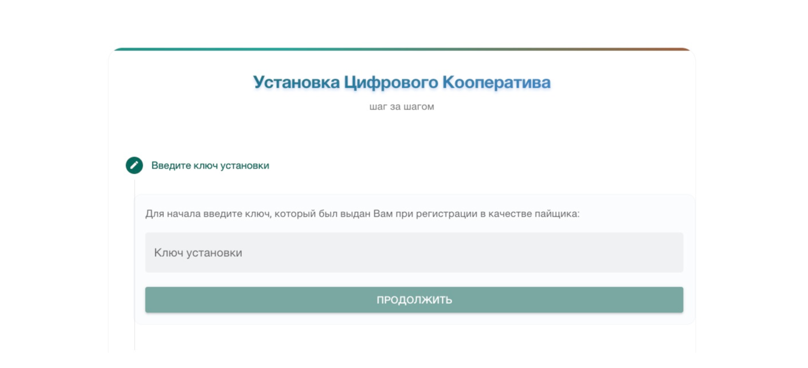
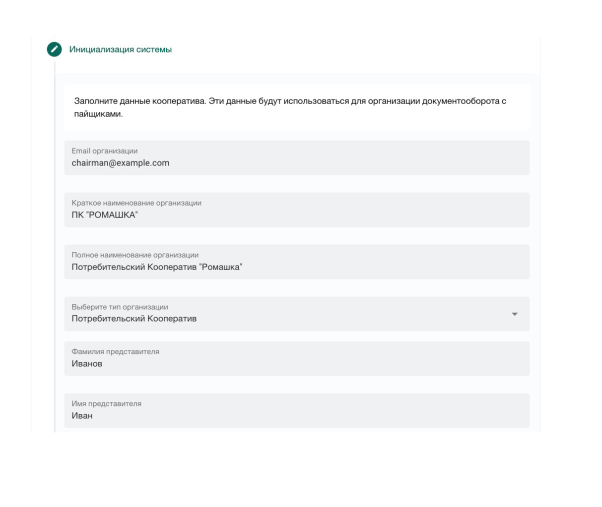
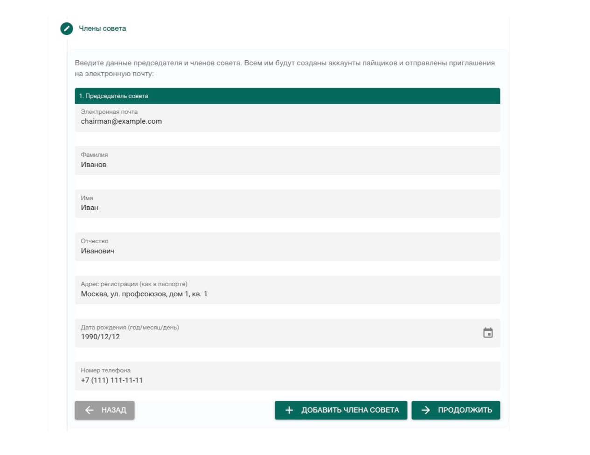
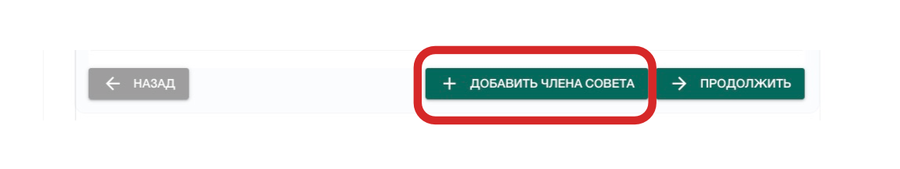
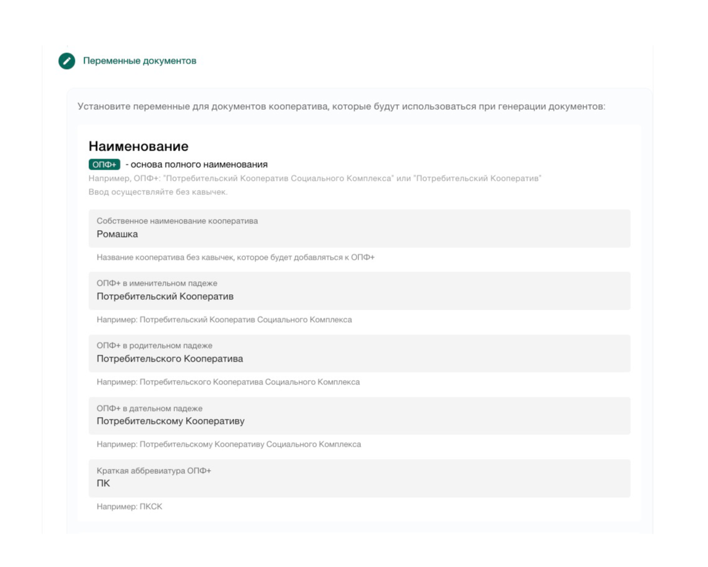
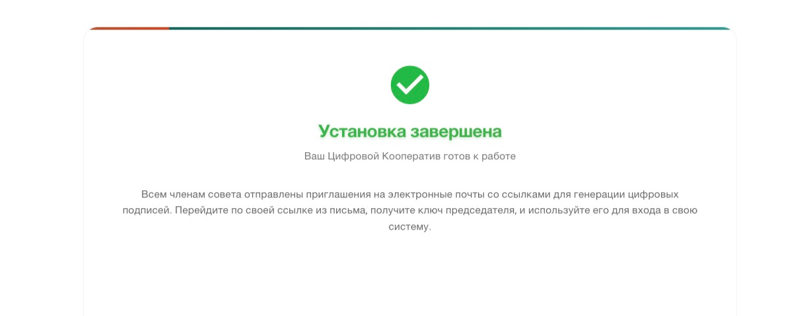
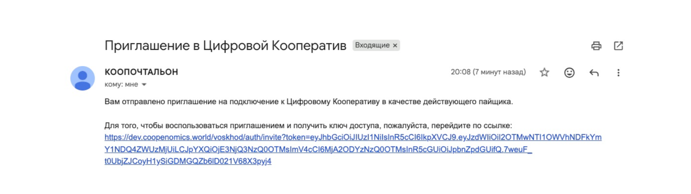
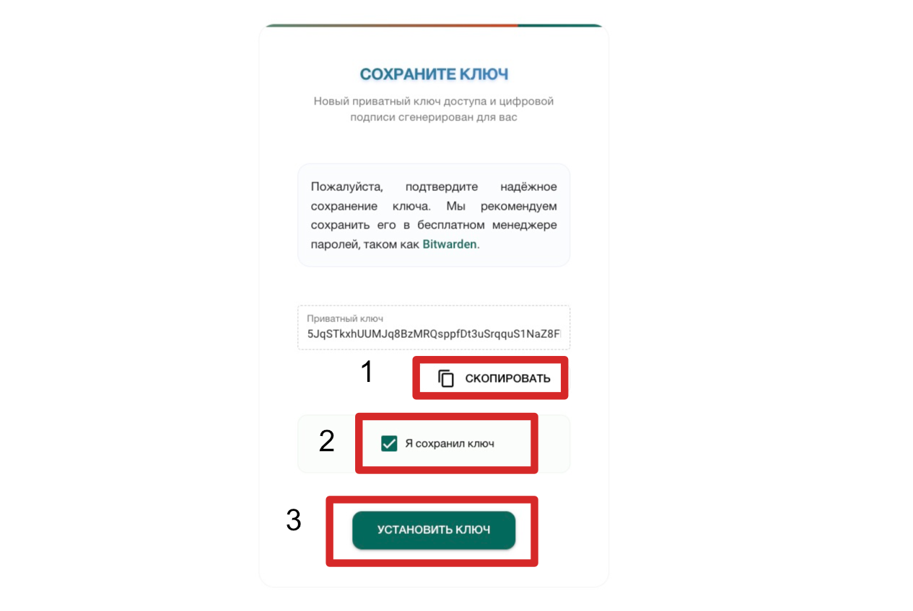

---
tags:
  - Председатель
  - Член совета
---

# Прежде всего

Вне зависимости от выбора [способа поставки](index.md) (cloud | self-hosted), установка системы производится председателей кооператива после технологического запуска на сервере. Процесс установки осуществляется на домене, который был указан для работы при подключении. 

## Установка

Установка федерации "Цифровой Кооператив" производится председателем кооператива и начинается с ввода ключа доступа, который был выдан оператором подсети при вступлении в него. 

!!!note "Оператор в РФ"
    В случае облачного подключения к подсети РФ оператором является ПК ВОСХОД.

### Шаг 1. Ввод ключа установки
Для начала установки председателю необходимо ввести приватный ключ, который был выдан оператором подсети. С помощью этого ключа будет произведена аудентификация прав доступа, после чего,  установка будет продолжена.  

### Шаг 2. Ввод или проверка данных организации
После ввода ключа установки система предложит ввести или проверить введенные данные юридического лица подключаемого кооператива. При поставке облачного решения данные всегда будут предзаполненны теми, которые предоставлялись оператору при регистрации в качестве пайщика. 

!!!warning "Важно"
    Вступление  в ПК ВОСХОД с целью подключения к подсети в РФ необходимо осуществлять юридическим лицом потребительского кооператива, которое в дальнейшем и будет пользователем федерации. При вступлении физического лица в качестве пайщика возможность подключения к платформе отсутствует.
    
    
### Шаг 3. Приглашение совета
После проверки заполнения всех данных организации и нажатия кнопки "Продолжить", необходимо создать цифровой совет кооператива. Для этого необходимо ввести данные всех членов совета, начиная с председателя. 

!!!danger "Председатель - первый"
    Данные председателя совета должны вводиться первым. 

После введения данных председателя совета, нужно аналогичным образом добавить всех оставшихся членов совета. Для этого, нажимайте кнопку "Добавить члена совета" и вводите данные членов совета по одному. 

### Шаг 4. Установка переменных документов

После введения данных членов совета и их перепроверки, нажимайте на кнопку "Продолжить". Следующим шагом система запросит у вас информацию, которая будет использоваться для генерации электронных документов. 

!!!note "Что такое ОПФ+ "
    ОПФ+ - это организационно-правовая форма + дополнительная характеристика организации, которая зафиксирована в Уставе как часть полного наименования. Например: Потребительский Кооператив или Потребительский Кооператив Социального Комплекса.

Остановимся на каждом пункте подробнее:

1. **Собственное наименование организации**. Например, в ПК "РОМАШКА" собственное наименование это РОМАШКА. Так и вводите, без кавычек.

2. **ОПФ+ в именительном падеже**. Например: Потребительский Кооператив Социального Комплекса. Если у вас другая характеристика организационно-правовой формы, то так ее и вводите - полностью и без кавычек в именительном падеже. Если дополнительной характеристики нет, то пишите как есть - Потребительский Кооператив.

3. **ОПФ+ в родительном падеже**. Например: Потребительского Кооператива или Потребительского Кооператива Социального Комплекса. 

4. **ОПФ+ в дательном падеже**. Например: Потребительскому Кооперативу Социального Комплекса.

5. **Краткая аббривиатура ОПФ+**. Например: ПК или ПКСК. 

6. **Ссылка на устав кооператива**. Приложите публично-доступную ссылку на Устав вашего кооператива. Ссылка будет использоваться при регистрации новых пайщиков для получения согласия об ознакомлении. 

7. **Запрашивать ли паспортные данные пайщиков**. Установите опцию, если в вашем кооперативе предусмотрен запрос паспортных данных (серия, номер, дата выдачи, кем выдан). Эти данные будут запрашиваться при регистрации новых пайщиков в их цифровых заявлениях на вступление. 

8. **Укажите почту по вопросам конфиденциальности**. Укажите вашу рабочую или специализированную почту, по которой с вами смогут связываться пайщики по вопросам конфиденциальности. Почта вшивается в политику конфиденциальности на сайте. 

Чтобы заполнить последующие поля, совету кооператива необходимо принять решение о приёме положение ЦПП "Цифровой Кошелёк", положение о простой электронной подписи, политику конфиденциальности, пользовательское соглашение, а также формы заявлений на вступление физлиц, юрлиц и ИП. Сгенерировать и скачать образцы документов можно по ссылке: <a href="https://coopenomics.github.io/generate-documents/connection-package/">https://coopenomics.github.io/generate-documents/connection-package/</a>

Примите решение совета и укажите номера и даты протоколов по каждому документу. У всех документов может быть общий номер протокола и дата принятия решения, если документы принимаются одним днем и одним протоколом решения совета. 

9. Номер и дата протокола о приёме положения ЦПП "Цифровой Кошелек". 

10. Номер и дата протокола о приёме соглашения о простой электронной подписи. 

11. Номер и дата протокола о приёме политики конфиденциальности. 

12. Номер и дата протокола о приёме пользовательского соглашения. 

13. Номер и дата протокола о приёме форм заявлений на вступление в кооператив. 

После введения и проверки всех вышеуказанных данных цифровой кооператив готов к завершению установки и началу работы. Нажимайте кнопку "Продолжить".

### Шаг 5. Выпуск ключа подписи

После завершения установки все члены совета получат на свои электронные почты приглашения на выпуск цифровых подписей. Вам, как председателю, приглашение также будет отправлено. Проверьте входящую почту и перейдите по ссылке для выпуска ключа цифровой подписи. 

Членам совета рекомендуйте сделать аналогично - проверить почту и перейти по ссылке для выпуска ключа цифровой подписи. 

После перехода по ссылке вы увидите предложение сохранить только что сгенерированный вам приватный ключ. Скопируйте ключ (1), затем подтвердите сохранение ключа (2), и обязательно нажмите кнопку "Установить ключ".

!!!warning "Без установки ключа - он не будет присвоен аккаунту"
    Без нажатия кнопки "Установить ключ" - ключ не применится в блокчейне и не будет доступен для использования пайщиком. 

После установки ключа вы будете перенаправлены на форму входа. Используйте почту председателя и только что полученный ключ для входа в систему. С этого момента цифровой кооператив готов к работе. 

## Онбординг
После входа в личный кабинет председателя совета вам будет предложено пройти онбординг по приему необходимых решений для работы на платформе, которые включают в себя 6 решений совета и 1 решение общего собрания пайщиков. 

-- картинка онбординга

Система предложит последовательно создать повестку собрания совета по каждому вопросу в отдельности, провести голосования и принять решения на платформе по следующим вопросам: 

- Утверждение положения о целевой потребительской программе "Цифровой Кошелек";

- Утверждение положения о порядке и правилах использования простой электронной подписи;

- Утверждение политики конфиденциальности;

- Утверждение пользовательского соглашения;

- Утверждение форм заявлений пайщиков на вступление в кооператив;

- О вступлении в ПК "ВОСХОД";

Для объявления повестки собрания совета нажмите кнопку "Объявить собрание совета" напротив первого вопроса. Система предложит ознакомиться с содержанием вопроса и текстом предлагаемого решения. После ознакомления с предложением повестки нажмите кнопку "Объявить" внизу документа. 

Объявление повестки создаст оповещения всем членам совета, а также создаст пункт для голосования на странице [Повестка совета](../council/agenda.md). После того, как решение по предложенному вопросу будет принято советом, система отметит пункт онбординга как выполненный. 

!!!note "Последовательно или параллельно"
    Вы можете объявить все собрания совета сразу или провести их последовательно одно за другим. Переход к импорту пайщиков станет доступен только после того, как все решения совета будут приняты. 

### Импорт пайщиков
После того, как все решения совета приняты, необходимо произвести импорт пайщиков. Импорт пайщиков осуществляется группами: физлица, юрлица и индивидуальные предприниматели по отдельности на основе CSV таблицы, шаблон которой будет предложено скачать и заполнить. [Подробнее об импорте](../council/participants.md). 

### Общее собрание
После импорта может потребоваться провести общее собрание по вопросу членства в союзе и другим вопросам. В общем собрании будут принимать участие все импортированные и зарегистрированные пайщики на момент проведения собрания. 

Повестка общего собрания будет с пунктом членства в союзе будет автоматически предложена при нажатии на кнопку "Объявить общее собрание" на странице онбординга. 

Для объявления общего собрания потребуется указать кто из пайщиков будет являться председателем общего собрания, а кто - его секретарем. Также, потребуется указать дату начала и завершения общего собрания, которая должна быть не ранее чем через 15 дней. 

Перед внесением предложения в совет на голосование вы можете внести изменения в повестку, добавив новые пункты, если это требуется. Как проходит общее собрание подробнее см. [здесь](). 

После выбора .
 

### Адаптация документооборота

Как было ранее отмечено, для корректной работы вашего кооператива согласно оцифрованной методологии союза потребительских обществ "Русь" может потребоваться адаптация базового документооборота. Что именно нужно будет адаптировать - вам подскажет представитель союза в кооперативном мессенджере. 

После подключения у вас будет 30 дней на то, чтобы провести необходимые собрания на платформе и принять соответствующие решения. В случае невыполнения адаптации союз может заблокировать работу кооператива на платформе. 

